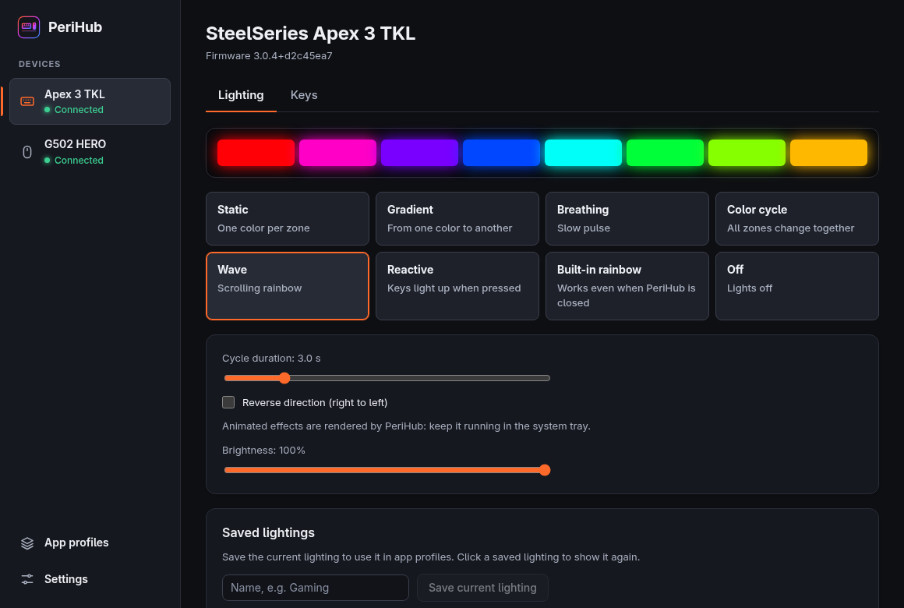
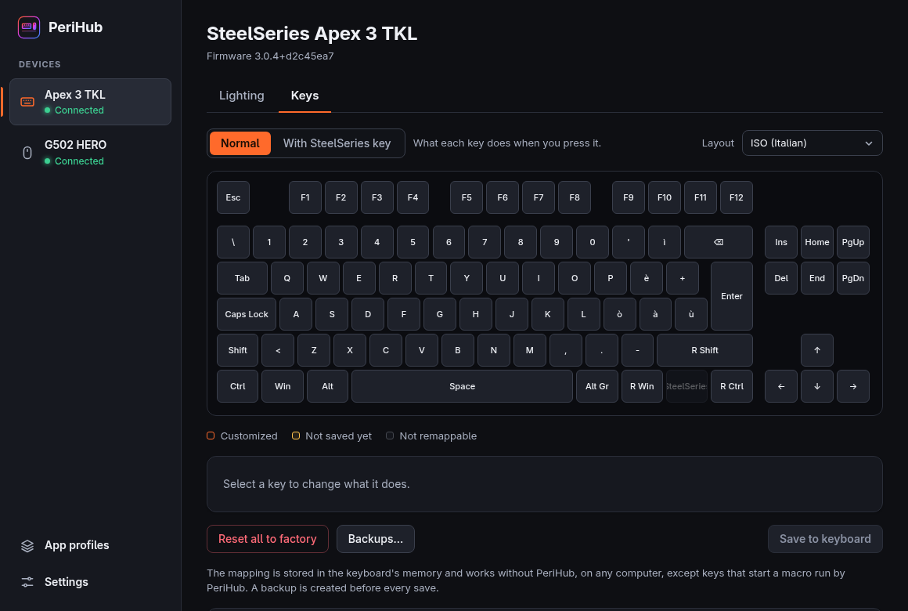
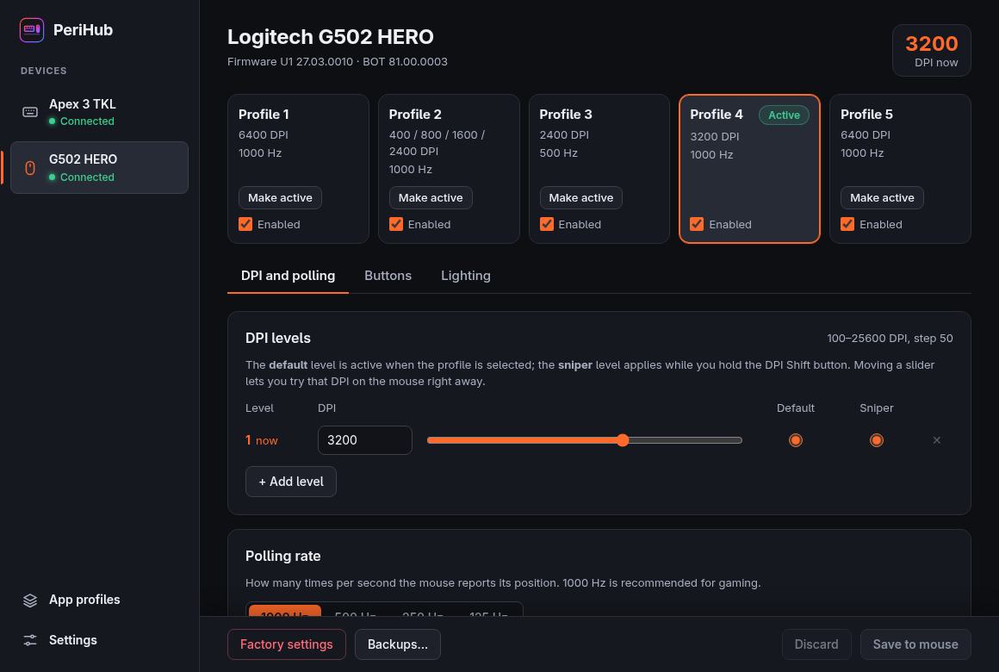
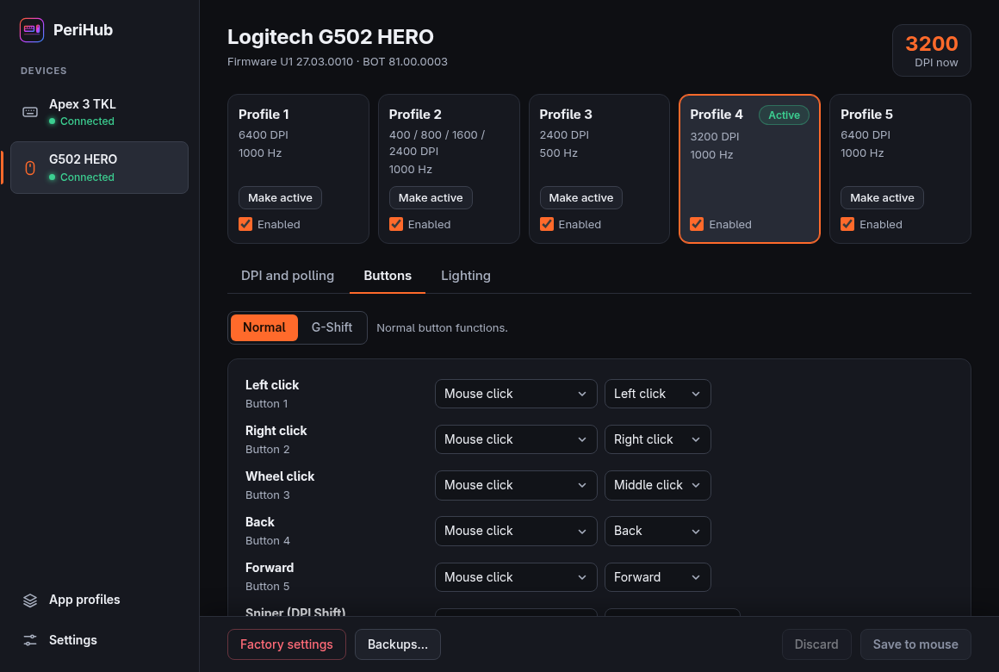
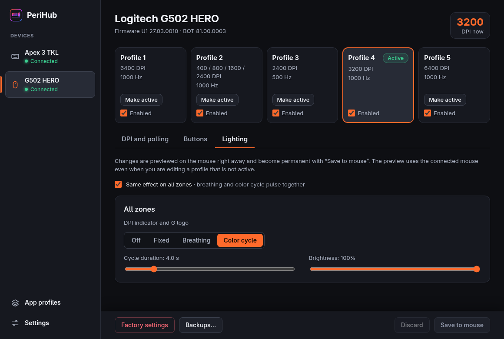

<p align="center">
  
</p>

<h1 align="center">PeriHub</h1>

<p align="center">
  <b>PeriHub for your peripherals</b>: one open-source app for your gaming keyboard and mouse<br>
  on <b>Windows and Linux</b>, without SteelSeries GG, Logitech G HUB or Corsair iCUE.
</p>

<p align="center">
  <a href="https://github.com/hex-dump/perihub/releases/latest"></a>
  <a href="https://github.com/hex-dump/perihub/actions/workflows/ci.yml"></a>
  <a href="LICENSE"></a>
</p>

<p align="center">
  <a href="https://github.com/hex-dump/perihub/releases/latest"><b>Download</b></a> ·
  <a href="https://hex-dump.github.io/perihub/">Website</a> ·
  <a href="docs/devices.md">Devices</a> ·
  <a href="https://github.com/hex-dump/perihub/discussions">Discussions</a>
</p>



- **Free and open source**, no account, no ads, no telemetry.
- **Small**: a 4 MB installer, about 3 MB of memory while it waits in the tray.
- **Settings stay in your devices**: key mapping, mouse profiles, DPI and macros keep working with PeriHub closed, on any PC.

## Contents

- [Devices](#devices)
- [What PeriHub can do](#what-perihub-can-do)
- [Experimental features](#experimental-features)
- [Download and install](#download-and-install)
- [Using PeriHub](#using-perihub)
- [Safety](#safety)
- [Performance](#performance)
- [FAQ](#faq)
- [Known limitations](#known-limitations)
- [Help and contributing](#help-and-contributing)
- [Credits and license](#credits-and-license)

## Devices

| Device | Support |
|---|---|
| **SteelSeries Apex 3 TKL** keyboard | ✅ Fully supported, tested on real hardware |
| **Logitech G502 HERO** mouse | ✅ Fully supported, tested on real hardware |
| **Logitech G502 X Wireless** mouse | ✅ Supported: profiles, DPI, buttons and macros, confirmed by a user on a real mouse |
| **Logitech G300** mouse | ✅ Supported: its three profiles can be read and edited, confirmed by a user on a real G300 |
| 28 more **Logitech G mice** (G Pro, G403, G703, G903, G305…) | Depends on the memory format each mouse reports: ✅ supported if that format was tested on another mouse, 🧪 experimental if PeriHub can write it but nobody has tried yet, 👁 read-only otherwise ([how it works](#logitech-mice-supported-by-memory-format)) |
| Logitech devices on a **Logi Bolt** or **Unifying** receiver (MX Master, MX Anywhere, MX Keys…) | 🧪 Experimental: recognized by the features they report; the DPI of those without onboard memory can be changed, everything else is read |
| 26 **Corsair mice** and 23 **Corsair keyboards** (KATAR, M65, M75, SCIMITAR, DARK CORE, K55, K70, K100…) | 🧪 Experimental: read, and one colour of lighting for the session, at your own risk |
| 33 **SteelSeries mice** (Rival, Sensei, Aerox, Prime, Kana, Kinzu) | 🧪 Experimental: these mice cannot report their settings; DPI, polling rate, colours and effects can be sent one at a time, never saved to the mouse ([how](#mice-and-keyboards-of-other-brands)) |
| 75 **Razer mice** (DeathAdder, Viper, Basilisk, Naga, Orochi…) on their USB cable | 🧪 Experimental: read; DPI and polling rate can be saved at your own risk ([how](#mice-and-keyboards-of-other-brands)) |
| 21 **ASUS ROG and TUF mice** (Chakram, Gladius II, Keris, Spatha X, Strix Impact, TUF Gaming M3…) | 🧪 Experimental: read; DPI, polling rate, button response, angle snapping and lighting can be changed at your own risk ([how](#mice-and-keyboards-of-other-brands)) |
| 3 **Glorious mice** (Model O/O-, Model D, Model O Eternal) with a cable | 🧪 Experimental: read; on Linux DPI and polling rate can be saved at your own risk, on Windows read-only for now ([how](#mice-and-keyboards-of-other-brands)) |
| 7 **Pulsar mice** (Xlite, X2, X2H, X2A, Xlite v4, X3, X3 LHD) on their USB cable | 🧪 Experimental: read; DPI, polling rate, debounce time, angle snapping, ripple control and motion sync can be saved at your own risk ([how](#mice-and-keyboards-of-other-brands)) |
| **Pulsar X2 CrazyLight, X3 LHD CrazyLight** on their USB cable | 🧪 Experimental: read; DPI, polling rate, lift-off, debounce, motion sync, angle snapping and ripple control can be saved at your own risk ([how](#mice-and-keyboards-of-other-brands)) |
| **Lamzu Atlantis** on its USB cable | 👁 Read-only ([how](#mice-and-keyboards-of-other-brands)) |
| 4 **Cooler Master mice** (MM530, MM711, MM720, MM730) | 🧪 Experimental: lighting only; colour, brightness and mode can be saved at your own risk ([how](#mice-and-keyboards-of-other-brands)) |
| **Roccat Kone Pure, Kone XTD, Kone EMP** | 👁 Read-only: profile in use, DPI levels and polling rate ([how](#mice-and-keyboards-of-other-brands)) |
| **Logitech G600** | 🧪 Experimental: read; DPI, polling rate and lighting of the profile in use can be saved at your own risk ([how](#mice-and-keyboards-of-other-brands)) |
| **Keyboards with QMK firmware**: every Vial keyboard, and VIA keyboards you turn on | 🧪 Experimental: read; lighting can be changed at your own risk, keymaps are left to VIA and Vial ([how](#mice-and-keyboards-of-other-brands)) |

The full list, with USB IDs, is in **[docs/devices.md](docs/devices.md)**. A device becomes fully supported once someone with it sends a test report: see [Help test your device](#help-test-your-device).

Not on the list? Open a [device request](https://github.com/hex-dump/perihub/issues/new?template=device_request.yml): any brand can be asked for.

## What PeriHub can do

### SteelSeries Apex 3 TKL

| Feature | Details | Saved in |
|---|---|---|
| Lighting | 8 zones: static, gradient, breathing, color cycle, wave, reactive (the zone of each key you press lights up), built-in rainbow, off | PC: PeriHub reapplies it when the keyboard is connected |
| Brightness | 0–100% in 17 steps, in sync with SteelSeries + F11/F12 | PC |
| Key remapping | Any key, on the normal layer and on the "SteelSeries key held" layer, with 10 keyboard layouts | **Keyboard**: works without PeriHub |
| Software macros | A key, such as SteelSeries + 1, starts a macro run by PeriHub | The key in the keyboard, the macro on the PC |

### Logitech G502 HERO

| Feature | Details | Saved in |
|---|---|---|
| Profiles | 5 onboard profiles: activate, enable or disable, restore factory settings | **Mouse** |
| DPI | Up to 5 levels from 100 to 25600, default and sniper level, live preview | Mouse |
| Polling rate | 125, 250, 500, 1000 Hz | Mouse |
| Buttons | 11 buttons plus the G-Shift layer: clicks, keys with modifiers, media keys, DPI and profile functions | Mouse |
| Lighting | Logo and DPI indicator: off, fixed color, breathing, color cycle, with live preview | Mouse |
| Macros | Recorded from the keyboard or built step by step: keys, clicks, media keys, scrolling, pauses | **Mouse**: works without PeriHub, on any PC |
| Software macros | What the mouse cannot do alone: repeat, type text, open a website or a program. Up to 8 | PC: PeriHub must be running |

### Logitech G300

| Feature | Details | Saved in |
|---|---|---|
| Profiles | 3 profiles: light colour (8 colours), report rate, 4 DPI levels with the default one, DPI shift | **Mouse** |
| Buttons | The wheel button and G4 to G9: clicks, keys with Ctrl, Shift, Alt or Win, DPI functions, next profile. The left and right buttons stay as they are | Mouse |
| Safety net | A backup of the three profiles before every save, every save read back, and **Keep?** after each one: without an answer the backup goes back after 15 seconds | |

### Everything else

- **App profiles**: while a game or an app is in focus, PeriHub can switch the keyboard lighting and the mouse profile, and switch back afterwards. On Windows and on Hyprland. PeriHub only reads the app's identifier (the executable name or window class), never window titles or contents.
- **Backups**: before every write to a device, PeriHub saves its memory, and **Backups…** puts it back.
- **Updates in one click** on Windows, signed, and only when you choose.

<table>
  <tr>
    <td></td>
    <td></td>
  </tr>
  <tr>
    <td></td>
    <td></td>
  </tr>
</table>

## Experimental features

Some devices have not been tested yet. PeriHub reads them and changes nothing, unless you use an experimental feature on the device's page.

### Logitech mice: supported by memory format

What decides how PeriHub saves a Logitech mouse's profiles is the format of its onboard memory, not the model: many models share one format, and the same model can change format with a firmware update. So PeriHub reads the format from the mouse every time it connects:

- **A format tested on a real mouse** (format 2 in 256-byte sectors, from the G502 HERO; format 3 in 255-byte sectors, from the G502 X Wireless): the mouse is supported, whatever the model.
- **A format PeriHub can write but nobody has tried yet** (format 2 or 3, in 255- or 256-byte sectors): the mouse page says so, and you can save at your own risk with the USB cable. Before your first save to that mouse PeriHub asks you to tick the **No warranty** box below. Each save is undone after 15 seconds unless you keep it.
- **Any other format** (4, 5 and newer): read-only.
- **Through a receiver** nothing is saved: a write over the radio has never been tried. With a tested format PeriHub still switches profiles and DPI levels there.

One test report is enough to make a format tested for every mouse that uses it: see [Help test your device](#help-test-your-device).

> [!CAUTION]
> **No warranty.** Experimental features have never been tried on your device. PeriHub is provided "as is", without any warranty, as its [license](LICENSE) says. If you use one, you do so at your own risk: the author of PeriHub is not responsible for any damage, malfunction or loss. PeriHub asks you to confirm this before each one is turned on, and before the first save to a mouse whose memory format is untested.

| | Logitech mice with an untested memory format | Corsair devices: **Try experimental lighting…** |
|---|---|---|
| What you can change | Profiles: DPI, polling rate, buttons, lighting, macros | One colour on every LED or key, for this session |
| When it is offered | USB cable, and a memory format PeriHub can write (profile format 2 or 3, 255- or 256-byte sectors) | Always, except while iCUE, OpenRGB, ckb-next or OpenLinkHub runs |
| What stays off | Enabling or disabling profiles, creating the profile list of a mouse nothing was saved to, saving through a receiver | Everything else: DPI, polling rate, buttons, the device's memory |
| Safety net | Only values the mouse accepts; a backup before every save; every write read back | Only the commands lighting needs; nothing is saved in the device |
| If something looks wrong | Each save is undone after 15 seconds unless you keep it, also after PeriHub closed or the mouse was unplugged | The device gets its own settings back after 15 seconds unless you keep it, when you quit PeriHub, and as soon as anything fails |
| Turn it off | Nothing to turn off: just don't save | On the device page, or **Turn off experimental lighting** in the tray menu |

### Mice and keyboards of other brands

ASUS mice are supported from the published documentation of their protocol ([libratbag](https://github.com/libratbag/libratbag)), not from a test on a real device. PeriHub reads them; their page can change the active profile's settings:

- **Apply** sends a change without saving it to the device's memory. It should last until the device is turned off, but that is not confirmed, so the page always shows a warning next to it.
- **Save to memory** also stores it in the device, after the **No warranty** box the first time.
- Either way PeriHub sends only the commands in its list for that device (never anything that touches firmware) and only values the device accepts. It saves a backup of the settings first and reads them back after, and the change is undone after 15 seconds unless you keep it, also after PeriHub closed or the device was unplugged. The undo of a **Save to memory** saves back the settings the device had when PeriHub connected.
- If anything the device answers does not look as documented, PeriHub changes nothing on it and the test report shows exactly what it answered.

Razer mice are supported from facts found in [OpenRazer](https://github.com/openrazer/openrazer), with no code copied. They store every change by themselves, so their page offers only **Save to memory**, after the **No warranty** box, with the same backup, read-back and 15-second undo. Their receivers and docks are left out, since some can be shared with a keyboard: use the USB cable.

Glorious mice are supported from the published documentation of their SinoWealth protocol ([libratbag](https://github.com/libratbag/libratbag)). Every change rewrites their settings in memory, so their page too offers only **Save to memory**, after the **No warranty** box, with the same backup, read-back and 15-second undo; PeriHub changes only the DPI of each slot and the polling rate, and writes everything else back as it read it, never on top of a reading that differs from the one taken when the mouse was connected. On Windows they are read-only for now: there the mouse does not say how long its settings are, and a write must. Only the ids that belong to Glorious are recognized: the generic SinoWealth ids are shared by other brands' mice, some with a different protocol.

The **Logitech G600** is supported from the documentation of its protocol in [libratbag](https://github.com/libratbag/libratbag). It keeps three profiles in vendor reports of its own, not HID++, and writing a profile stores it, so its page too offers only **Save to memory** on the profile in use, after the **No warranty** box, with the same backup, read-back and 15-second undo. PeriHub changes the DPI of the slots that are on, the polling rate and the lighting, writes the buttons and everything else back as it read it, and never writes on top of a profile that changed since the mouse was connected.

The **Roccat Kone Pure, Kone XTD and Kone EMP** are read only, from [libratbag](https://github.com/libratbag/libratbag): PeriHub shows the profile in use, its DPI levels and polling rate, and changes nothing, since the sources disagree on what a write needs.

**Pulsar mice** on their USB cable (Xlite, X2, X2H, X2A, Xlite v4, X3 and X3 LHD) are supported from [pulsar-mouse-linux](https://github.com/packerlschupfer/pulsar-mouse-linux), a recent project built from USB captures. They store every change by themselves, so their page offers only **Save to memory**, after the **No warranty** box, with the same backup, read-back and 15-second undo. PeriHub changes the polling rate, debounce time, angle snapping, ripple control, motion sync and the DPI of each stage of the profile in use; it never switches or resets a profile, and leaves buttons, lighting and lift-off alone. Their wireless dongles are left out.

The **Pulsar X2 CrazyLight and X3 LHD CrazyLight** on their cable speak another protocol, also from pulsar-mouse-linux, whose author confirmed reads and writes on both: the same **Save to memory** with backup, read-back and undo, and every value checked against the check byte the mouse stores beside it. The **Lamzu Atlantis** shares that protocol ([lamzu-cfg](https://github.com/LeadSun/lamzu-cfg)) and is read only for now.

The lighting of four **Cooler Master mice** (MM530, MM711, MM720, MM730) is supported from the USB captures of Cooler Master's own app that users attached to [OpenRGB](https://gitlab.com/CalcProgrammer1/OpenRGB)'s device requests, with no code copied. Every change goes through the app's save sequence, so their page offers only **Save to memory**, after the **No warranty** box, with the same backup, read-back and 15-second undo: colour and brightness of the mode in use, and steady, breathing, colour cycle or off.

Keyboards with **QMK firmware** are supported from facts found in the [QMK](https://github.com/qmk/qmk_firmware) and [Vial](https://github.com/vial-kb/vial-qmk) sources, with no code copied. They have no USB ids of their own, so PeriHub finds them by the raw HID channel that VIA and Vial use, and lists them on the **QMK keyboards** page. **Vial** keyboards say so in their serial number and are read by themselves. Any other keyboard with that channel is read only after you turn it on as a VIA keyboard, since its firmware might give VIA's bytes another meaning. PeriHub shows the protocol versions, layers and macros, and the lighting: effect, speed, colour and brightness, with **Apply** and **Save to memory** as above. It changes the lighting only on Vial keyboards with VialRGB and on VIA firmware from 2023 on (protocol 12 or 13), where the protocol says exactly how; VIA effects have no names, so their page offers off and the effect in use. Keymaps, macros, the bootloader and the memory resets are never touched: use VIA or Vial for them, and close them while PeriHub reads the keyboard.

SteelSeries mice are supported from [rivalcfg](https://github.com/flozz/rivalcfg), and PeriHub sends exactly the bytes rivalcfg's own tests expect. These mice **cannot report their settings**, so PeriHub cannot show, check or undo them: **Send** changes one setting until the mouse is unplugged or turned off, under a warning that is always on screen, and PeriHub never saves to their memory until someone has tested one. Unplugging the mouse brings back what it has saved.

### Help test your device

If you own a device marked 🧪 or 👁:

1. Install PeriHub and quit the official app (G HUB, Logitech Gaming Software, iCUE).
2. Open the device's page in PeriHub and press **Open test form**. It opens a report on GitHub with what PeriHub read already filled in: no key presses, apps or log lines.
3. Check that what PeriHub shows matches your device, and send it. You need a free GitHub account.

Once someone confirms a model, it becomes fully supported for everyone. For a Logitech mouse, the confirmation counts for its memory format, so for every other mouse that uses it too.

## Download and install

Get the file for your system from the [releases page](https://github.com/hex-dump/perihub/releases/latest).

### Windows

1. Download `PeriHub_…_x64-setup.exe` and run it.
2. The installer is not code-signed yet ([code signing policy](CODE_SIGNING.md)). If SmartScreen blocks it, click **More info → Run anyway**.
3. **Quit SteelSeries GG, Logitech G HUB and Corsair iCUE**, and turn off their autostart: two programs talking to the same device get in each other's way.

No drivers are needed. PeriHub tells you when a new version is out, in the tray menu and in **Settings → Updates**.

**With Scoop**: [@Kissshot-2003](https://github.com/Kissshot-2003) maintains a [bucket for PeriHub](https://github.com/Kissshot-2003/perihub-scoop). Update it with `scoop update perihub`.

```pwsh
scoop bucket add perihub-scoop https://github.com/Kissshot-2003/perihub-scoop
scoop install perihub-scoop/perihub
```

### Linux

| Distribution | File |
|---|---|
| Debian, Ubuntu | `PeriHub_…_amd64.deb` |
| Fedora, openSUSE | `PeriHub-…-1.x86_64.rpm` |
| Arch, CachyOS | the `perihub-bin` package, built from this repository (below) |
| Any, with Flatpak | `PeriHub_…_x86_64.flatpak` (below) |
| Any other | `PeriHub_…_amd64.AppImage`: `chmod +x` it and run it |

On Arch-based distributions, until `perihub-bin` is on the AUR:

```sh
git clone https://github.com/hex-dump/perihub.git
cd perihub/packaging/aur/perihub-bin
makepkg -si
```

**Flatpak**: install the downloaded file for your user, with its name in place of `X.Y.Z`. PeriHub runs on the GNOME runtime, which Flatpak downloads from Flathub, offering to set Flathub up if it is not:

```sh
flatpak install --user PeriHub_X.Y.Z_x86_64.flatpak
```

PeriHub is not on Flathub, so the Flatpak does not update by itself: install the next release's file the same way. Like the AppImage, it needs the udev rule below. On desktops without the Background portal, such as Hyprland, add `flatpak run io.github.hex_dump.perihub --hidden` to the desktop's own autostart (an `exec-once` line on Hyprland): PeriHub says so when you tick **Start PeriHub when I log in** in **Settings**.

#### USB permissions

The `.deb`, `.rpm` and `perihub-bin` packages install a udev rule that lets PeriHub open the devices. With the **AppImage** or the **Flatpak**, if PeriHub shows "permission denied", install it by hand, and again after an update that adds devices:

```sh
sudo curl -o /etc/udev/rules.d/70-perihub.rules \
  https://raw.githubusercontent.com/hex-dump/perihub/main/packaging/linux/70-perihub.rules
sudo udevadm control --reload && sudo udevadm trigger
```

The rule opens only the interfaces that carry settings, and only for the user at the screen. The ones that report what you type and how you move the mouse stay closed.

<details>
<summary><b>Optional rules</b>: reactive lighting and software macros</summary>

<a id="optional-reactive-lighting"></a>

#### Optional: reactive lighting, and keyboard keys that start software macros

Reactive lighting reads key presses, and so does a key of the Apex 3 TKL that starts a software macro. This needs a second rule, [`71-perihub-keys.rules`](packaging/linux/71-perihub-keys.rules). PeriHub offers to install it from **Lighting → Reactive** and from the **Keys** page, asking for your password, and can remove it from there.

> [!WARNING]
> Linux cannot give this permission to PeriHub alone. With the rule installed, **every program running under your user account can read everything you type on the Apex 3 TKL**, passwords included, even while PeriHub is closed. Install it only if you want these features and trust all the software you run.

PeriHub itself reads key presses only while reactive lighting is on or a keyboard key starts a macro, and never stores, logs or sends what you type.

#### Optional: Unifying receivers

Linux puts the Unifying receivers in a mode where what you type on the keyboards paired with them comes through the same interface PeriHub needs, so the default rule leaves them closed. When PeriHub finds a Unifying receiver it cannot open, the mouse page explains this and offers to install [`73-perihub-unifying.rules`](packaging/linux/73-perihub-unifying.rules), asking for your password, and can remove it from there. If Solaar is installed, its own rule already opens the receiver.

> [!WARNING]
> Linux cannot give this permission to PeriHub alone. With the rule installed, **every program running under your user account can read everything you type on the keyboards paired with a Unifying receiver**, passwords included, even while PeriHub is closed. Install it only if you want PeriHub to reach those devices and trust all the software you run.

PeriHub itself only reads the answers of the devices it asks, and drops everything else that arrives on that interface without storing, logging or sending it.

#### Optional: QMK keyboards

QMK keyboards have no USB ids PeriHub's rule could list, so each one needs a line of its own. When the system refuses PeriHub a QMK keyboard, the **QMK keyboards** page offers to add one to [`73-perihub-qmk.rules`](docs/protocols/qmk-via-vial.md#on-linux), asking for your password, and can remove it from there. PeriHub first reads, in `/sys`, the descriptor of each of the keyboard's interfaces, and the line opens only the one that holds the raw HID channel and nothing else: what you type arrives on another interface, which stays closed. If Vial's own rule is installed, PeriHub can already read Vial keyboards.

#### Optional: software macros

Software macros type and click through a virtual keyboard and mouse (`/dev/uinput`). Many gaming systems already allow it, and PeriHub tells you so on the **Buttons** and **Keys** pages. Otherwise it offers to install [`72-perihub-uinput.rules`](packaging/linux/72-perihub-uinput.rules) from there.

> [!WARNING]
> With this rule, **every program running under your user account can simulate a keyboard and a mouse**, and type or click anything as if it were you. Install it only if you want software macros and trust all the software you run.

</details>

## Using PeriHub

- **Keyboard → Lighting**: pick an effect. It applies at once and is remembered.
- **Keyboard → Keys**: pick your layout, click a key, choose its new function and press **Save to keyboard**. **With SteelSeries key** changes what keys do while the SteelSeries key is held.
- **Mouse**: pick a profile at the top, then change DPI, buttons and lighting. Nothing is written until you press **Save to mouse**. DPI and lighting are previewed live; leaving the page brings the saved settings back.
- **G-Shift**: give "G-Shift" to a button. While you hold it, the other buttons do what the G-Shift tab says.

**Closing the window does not quit PeriHub.** It keeps running in the tray with much less memory, to animate the keyboard lighting and reapply it after a replug or a wake-up. To quit: **Quit** in the tray menu, or **Settings → Quit PeriHub**.

- **Windows 11** hides new tray icons behind the **^** arrow. To keep PeriHub visible: **Settings → Personalization → Taskbar → Other system tray icons → PeriHub**.
- **Autostart** can be turned on in Settings. On Hyprland it needs `xdg-desktop-autostart.target` (uwsm or systemd), or `exec-once = /path/to/perihub --hidden` in your configuration. For the tray icon you need a bar with a tray, such as Waybar or Noctalia.

## Safety

PeriHub never touches firmware. It uses the same settings commands as the official apps, with more safeguards:

- **Only known commands.** The code can send only commands that have been checked, and refuses the others before they reach the device. The command that restarts the Apex into its firmware updater cannot even be written. On Logitech mice only a short list of HID++ features is used, and a receiver's pairing commands are never sent. On Corsair devices only property reads, and with experimental lighting the commands lighting needs, can get through.
- **Untested devices are only read**, unless you use an [experimental feature](#experimental-features). A Logitech mouse whose memory format is untested is saved to only after the No warranty box, with the USB cable, and each save is undone unless you keep it.
- **Every write is checked.** Mouse profiles are changed on top of their original bytes and read back byte by byte. The keyboard's key mapping is tried in RAM first and saved only if the read-back matches.
- **Backups** before every write: in `~/.config/perihub/backups/` on Linux (`~/.var/app/io.github.hex_dump.perihub/config/perihub/backups/` in the Flatpak) and `%APPDATA%\perihub\backups\` on Windows. **Backups…** puts one back, writing only what differs.
- **Factory profiles are never written**: they are only read, to restore a profile.
- **Your key presses stay on your PC.** Reactive lighting and software macros read keys only while they need to, keep only which zone to light or which macro to start, and drop keys from other devices at once. Nothing you type is stored, logged or sent.
- **No data leaves your PC.** PeriHub works offline. The only connection: on Windows it asks GitHub for the latest version at start and once a day (you can turn this off), and installs an update only if you ask and its signature matches PeriHub's key.

More: [how the release files are signed](CODE_SIGNING.md) · [reporting a security issue](SECURITY.md).

## Performance

| PeriHub 0.5.5 on Windows | |
|---|---|
| Download | **3.9 MB** installer |
| On disk | **17 MB** |
| In the tray | **3 MB** of memory, **0.05%** of one CPU core |
| Window open | **39 MB** of memory, **0.2%** of one CPU core |
| Background services, account, ads, telemetry | none |

PeriHub is written in Rust and draws its window with WebView2, the web engine of Windows, instead of shipping its own browser. The engine runs only while the window is open. An animated lighting effect, drawn by PeriHub frame by frame, adds about 0.6% of one core. How these numbers were measured: [docs/development.md](docs/development.md#performance-measurements).

We do not publish numbers for G HUB or GG: we have not measured them on the same machine, and they support many more devices and features. To compare on your PC, run one app at a time and look at Task Manager → Processes. G HUB is a trademark of Logitech, SteelSeries GG of SteelSeries, iCUE of Corsair; PeriHub is not affiliated with them.

## FAQ

**Can I keep GG, G HUB or iCUE running?**
No: quit them and turn off their autostart. G HUB, for example, takes control of the mouse when it starts and after every wake-up, so the mouse stops using its onboard profiles. PeriHub shows a warning while G HUB runs, and gives the mouse its profiles back when G HUB is closed.

**Does this void my warranty?**
PeriHub does not touch the firmware. It writes only settings (profiles, key mapping) that the official apps write too. Experimental features come with [no warranty](#experimental-features).

**Why does the keyboard go back to the rainbow when PeriHub is closed?**
The Apex 3 TKL does not store colors, with GG too. PeriHub reapplies them as soon as it sees the keyboard.

**How do I undo a change?**
**Backups…** on the mouse page or the keyboard's Keys page, then **Restore** on the newest backup. For factory settings: **Keys → Reset all to factory** on the keyboard, **Factory settings** on each mouse profile.

**Something does not work: what should I attach to a bug report?**
The log file: **Settings → Problems → Open log folder**. It records devices connecting, errors and updates, never your key presses or the apps you use.

**Is PeriHub available in other languages?**
The interface is in English. More languages are planned.

## Known limitations

- **Windows**: tested on a real Windows 11 PC (lighting, key remapping, mouse profiles and macros, app profiles, tray, autostart, updates, software macros). Creating software macros has been tried on Linux only.
- **Logitech G300**: reading and saving were confirmed by one user, on Windows ([issue #21](https://github.com/hex-dump/perihub/issues/21)). No G300 has been tried on Linux yet.
- **Logitech mice through a LIGHTSPEED receiver** are never saved to: use the USB cable. With a tested memory format PeriHub switches their profile and DPI level. The receivers have not been tried on real hardware yet ([issue #4](https://github.com/hex-dump/perihub/issues/4)), and their buttons do not start software macros.
- **Devices on a Logi Bolt or Unifying receiver**, such as the MX Master 3S, are experimental: nobody has tried PeriHub on one yet ([issue #17](https://github.com/hex-dump/perihub/issues/17)). Each one gets a page with what it can do, its battery and DPI, and a test report. Only the DPI can be changed, on devices without onboard memory: PeriHub sets it in the device's RAM, so the device forgets it when it is turned off or falls asleep, and PeriHub sets it again when it connects or wakes up (it checks every 10 seconds), while PeriHub is running. Other Logitech devices PeriHub does not know, also behind a LIGHTSPEED receiver, get a read-only page. Solaar and logiops may undo it: PeriHub says so when one of them runs. Bluetooth and the USB cable of these devices are not supported yet. On Linux the Unifying receivers need an [optional rule](#optional-unifying-receivers), because the typing of the keyboards paired with them goes through the same interface.
- **Corsair devices** have not been tried on real hardware yet. With more than one device on the same receiver, only the first one is shown, and the Slipstream V2 receiver is not recognized.
- **App profiles** work on Windows and Hyprland only. They switch lighting and mouse profiles, not key mappings.
- **Software macros** on Linux skip characters the keyboard layout cannot type. On Windows many games ignore typed text, but not keys.
- **Not available yet**: GameSense. **Out of scope**: SteelSeries Sonar and Moments, G HUB Lua scripts.

## Help and contributing

- **Questions and ideas**: [Discussions](https://github.com/hex-dump/perihub/discussions).
- **Bugs**: a [bug report](https://github.com/hex-dump/perihub/issues/new?template=bug_report.yml) with your system, the device, what PeriHub showed and the log file.
- **Test reports**: [Logitech mice](https://github.com/hex-dump/perihub/issues/new?template=mouse_test.yml), [Corsair devices and the G300](https://github.com/hex-dump/perihub/issues/new?template=device_test.yml), or **Open test form** in the app.
- **New devices**: a [device request](https://github.com/hex-dump/perihub/issues/new?template=device_request.yml) with the model and USB ID.
- **Code**: how to build, test and find your way around the code is in [docs/development.md](docs/development.md).

### Support the project

PeriHub is free. If it spared you an official app and you'd like to say thanks, you can [buy me a coffee](https://buymeacoffee.com/hexdump1). It is entirely optional and unlocks nothing: it helps buy new devices to add. Testing PeriHub on your hardware helps just as much.

## Credits and license

The protocols were worked out thanks to:

- [OpenRGB](https://gitlab.com/CalcProgrammer1/OpenRGB): the Apex 8-zone lighting protocol. No code was copied.
- [libratbag](https://github.com/libratbag/libratbag) (MIT): Logitech HID++ 2.0, onboard profiles, the list of Logitech mice and the G300's format.
- [gorkemgun/apex-3-tkl](https://github.com/gorkemgun/apex-3-tkl) (MIT): the Apex 3 TKL key mapping.
- [ckb-next](https://github.com/ckb-next/ckb-next) and [OpenLinkHub](https://github.com/jurkovic-nikola/OpenLinkHub): Corsair's protocol, described in our own words in [docs/protocols/corsair-bragi.md](docs/protocols/corsair-bragi.md). No code was copied.
- [libratbag](https://github.com/libratbag/libratbag) (MIT), and OpenRGB for each mouse's interface: the ASUS ROG and TUF mice and their protocol, in [docs/protocols/asus-rog.md](docs/protocols/asus-rog.md).
- [OpenRazer](https://github.com/openrazer/openrazer): the Razer mice and their protocol, described in our own words in [docs/protocols/razer-mice.md](docs/protocols/razer-mice.md). No code was copied.
- [libratbag](https://github.com/libratbag/libratbag) (MIT): the Glorious mice and their SinoWealth protocol, in [docs/protocols/sinowealth-glorious.md](docs/protocols/sinowealth-glorious.md), the Logitech G600, in [docs/protocols/logitech-g600.md](docs/protocols/logitech-g600.md), and the Roccat Kone mice, in [docs/protocols/roccat-kone.md](docs/protocols/roccat-kone.md).
- [pulsar-mouse-linux](https://github.com/packerlschupfer/pulsar-mouse-linux) (MIT): the Pulsar mice and their Sonix protocol, in [docs/protocols/pulsar-sonix.md](docs/protocols/pulsar-sonix.md), and with [lamzu-cfg](https://github.com/LeadSun/lamzu-cfg) (MIT) the CrazyLight and Lamzu mice, in [docs/protocols/nordic-mice.md](docs/protocols/nordic-mice.md), with what each USB interface carries from [Pulsar-X3-Web-Config](https://github.com/santoshpanna/Pulsar-X3-Web-Config) (MIT).
- [rivalcfg](https://github.com/flozz/rivalcfg) (WTFPL): the SteelSeries mice, their commands and the reports its tests expect, in [docs/protocols/steelseries-mice.md](docs/protocols/steelseries-mice.md).
- The USB captures of Cooler Master's app attached to [OpenRGB](https://gitlab.com/CalcProgrammer1/OpenRGB)'s device requests: the Cooler Master mice's lighting, described in our own words in [docs/protocols/coolermaster-mm.md](docs/protocols/coolermaster-mm.md). No code was copied.
- [QMK](https://github.com/qmk/qmk_firmware) and [Vial](https://github.com/vial-kb/vial-qmk): the VIA and Vial protocols and how QMK keyboards present their raw HID channel, described in our own words in [docs/protocols/qmk-via-vial.md](docs/protocols/qmk-via-vial.md). No code was copied.

The notices of the projects PeriHub takes code or data from are in [THIRD-PARTY-NOTICES.md](THIRD-PARTY-NOTICES.md), which comes with every package.

PeriHub is released under the [MIT license](LICENSE). It is not affiliated with SteelSeries, Logitech, Corsair, ASUS, Razer, Glorious, Roccat, Pulsar, Lamzu or Cooler Master; product names belong to their owners.
